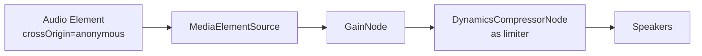

# Audio Normalization

Different radio stations broadcast at different volume levels. This document explains how volume normalization is handled to provide a consistent listening experience.

## What is LUFS?

**LUFS** (Loudness Units relative to Full Scale) is the industry standard for measuring perceived loudness. LUFS accounts for how human ears perceive sound.

| LUFS | Usage                               |
| ---- | ----------------------------------- |
| -14  | Spotify/YouTube target (loud)       |
| -16  | Broadcast standard (moderate)       |
| -23  | EBU R128 reference (quiet, dynamic) |

**Values closer to 0 are louder.** -7 LUFS is louder than -15 LUFS. A 10 dB difference is roughly twice (or half) the perceived loudness.

## The Problem

Switching between stations can cause volume jumps. For example:

| Station     | LUFS  | Perceived |
| ----------- | ----- | --------- |
| Vibe FM     | -9.0  | Loud      |
| Magic Malta | -9.0  | Loud      |
| Bay FM      | -13.5 | Moderate  |

Switching from Vibe FM (-9.0 LUFS) to Bay FM (-13.5 LUFS) is a 4.5 dB drop, roughly 1.4x quieter.

## How Spotify Handles This

Spotify uses **EBU R128 loudness normalization**:

1. Each track is pre-analyzed for perceived loudness (LUFS)
2. A gain adjustment is stored in metadata
3. During playback, gain is applied to reach target loudness (-14 LUFS)
4. A limiter prevents clipping when boosting quiet tracks

## Our Approach

We store the **measured LUFS value** for each station and calculate the gain adjustment at runtime.

```typescript
const TARGET_LUFS = -16;
const gainDb = TARGET_LUFS - station.lufs;
```

For example:

- Vibe FM at -9.0 LUFS -> gainDb = -16 - (-9.0) = **-7.0 dB** (reduce volume)
- ONE Radio at -20.0 LUFS -> gainDb = -16 - (-20.0) = **+4.0 dB** (boost volume)

### How It Works

```typescript
function calculateEffectiveVolume(userVolume, stationLufs) {
  const baseVolume = userVolume / 100;
  const gainDb = TARGET_LUFS - stationLufs;
  const stationMultiplier = Math.pow(10, gainDb / 20); // dB to linear
  return Math.min(1, Math.max(0, baseVolume * stationMultiplier));
}
```

`HTMLAudioElement.volume` is clamped to 0-1, so this path can only reduce loud stations or boost quiet ones while the user's volume is below 100%. Stations that need more than that use the boost path below.

### Boosting Very Quiet Stations

Some stations broadcast far below the target (Bay Retro at -29.5 LUFS needs about +13.5 dB). For those, `stations.ts` sets `boost: true` and playback goes through the Web Audio API instead of the element volume:



- The `GainNode` is not limited to 1, so the station can be amplified beyond 100%. The user volume and mute also apply through it.
- The boost is capped at **+12 dB** (`MAX_BOOST_DB`) so the limiter is not driven too hard. Bay Retro lands at about -18 LUFS instead of -16, close enough.
- The limiter (threshold -3 dBFS, ratio 20:1, 3 ms attack, 250 ms release) stops the boosted signal from clipping.
- A second `<audio>` element is used for boosted stations. A `MediaElementSource` can never be disconnected from its element, and a connected element plays silence for streams without CORS headers, so the regular element must never join the graph.

**`boost` requires CORS.** Web Audio can only read cross-origin audio when the stream sends `Access-Control-Allow-Origin`. Setting `crossOrigin` on a stream without it breaks playback entirely, so verify first:

```bash
curl -s -o /dev/null -D - --max-time 5 -H "Origin: https://kollox.fm" <streamUrl> | grep -i access-control-allow-origin
```

The header must be `*` or echo the site origin. Only then add `boost: true`.

## Measuring Station Loudness

Loudness is measured with ffmpeg's EBU R128 filter (integrated LUFS) and written straight into `stations.ts`:

```bash
npm run loudness
```

What a run does:

1. Samples each station several times, spaced apart, so the samples catch different songs, ads or a presenter talking rather than one 20-second window.
2. Runs several ffmpeg processes at once so a full sweep of all stations takes about 25 minutes instead of hours.
3. Takes the **median** of the successful samples and flags a station as **UNSTABLE** when its samples differ by more than 3 dB.
4. Replaces the `lufs:` number of each measured station in `stations.ts`, rounded to the nearest 0.5 dB (nothing else in the file changes), and runs Prettier on it.
5. Skips stations that failed and changes smaller than 1 dB (about the smallest difference a listener notices), so a run only produces meaningful diffs.

Options:

| Flag                   | Default     | Meaning                                               |
| ---------------------- | ----------- | ----------------------------------------------------- |
| `--duration <seconds>` | 60          | Length of each sample                                 |
| `--samples <n>`        | 3           | Samples per station                                   |
| `--spacing <seconds>`  | 90          | Minimum gap between a station's samples               |
| `--concurrency <n>`    | 5           | Max simultaneous ffmpeg processes                     |
| `--station <id[,id]>`  | all enabled | Measure only these station ids                        |
| `--dry-run`            | off         | Print the old -> new summary without writing the file |

Typical use:

```bash
# A single station, for example one just added
npm run loudness -- --station vibe-fm

# Preview a full sweep without touching stations.ts
npm run loudness -- --dry-run

# A quick sanity check
npm run loudness -- --station bay-fm --samples 2 --duration 15 --spacing 10
```

Run the full sweep occasionally (after adding stations, or when a station sounds off), not routinely: loudness drifts a little with content, and the 1 dB threshold absorbs that. Re-run an UNSTABLE station on its own another day before trusting its value, and review the diff before committing.

### Why Radio 105 Stations Vary

Despite being from the same host, Radio 105 channels vary by several dB because different music genres are mastered at different loudness levels:

- **Louder:** Country, Eurovision, Urban (heavily compressed modern masters)
- **Quieter:** Mellow, Maltin (more dynamic range, folk/acoustic content)

## Limitations

### Stations Without CORS Headers

Most stream hosts used here send `Access-Control-Allow-Origin` (checked October 2026):

| Host                                                       | Header                            |
| ---------------------------------------------------------- | --------------------------------- |
| stream.v3.network (Bay stations)                           | `*`                               |
| radioca.st (Vibe, Campus, Radio 105 stations)              | `*`                               |
| voscast.com (ONE, NET, Smooth, Maltin Biss, BKR, All Rock) | `*`                               |
| zeno.fm (Malta Sunshine, Buzz stations)                    | `*`                               |
| radioking.com, myradiostream.com, shoutca.st               | `*`                               |
| 19cloudsnetwork.gr, radio.co, wannastream.com              | echoes the request origin         |
| headend.smashmalta.com (Smash FM)                          | only `https://www.smashmalta.com` |

Smash FM therefore cannot use `boost`. It plays normally through the regular element and, at -11 LUFS, does not need a boost anyway.

### No Real-Time Analysis

Stations are measured offline and the value is stored. Real-time loudness analysis in the browser would be possible for CORS-enabled streams, but static values keep the player simple and work for the stations without CORS too.

## Files

- `src/lib/types/radio.ts` - RadioStation interface with `lufs` and `boost` fields
- `src/lib/hooks/audio-player.tsx` - Volume calculation from LUFS, Web Audio boost chain
- `src/lib/data/stations.ts` - Station data with LUFS values
- `scripts/analyze-station-loudness.ts` - Measures stations and writes the values back
